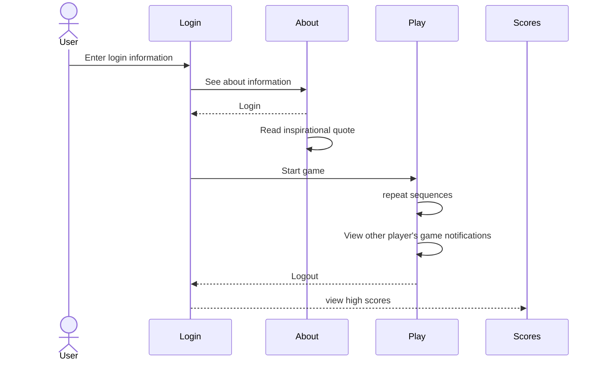

# Simon

[My Notes](notes.md)

In 1978 Milton-Bradley, now Hasbro, released an electronic game named Simon. It was cutting edge at the time since there were so few electronic games, and all the cool kids had one.

We are going to build a peer to peer multiplayer web application modeled after Simon. We will build it together by adding new functionality every time we learn a new technology. The example version of code and production deployment for each iteration are available to you. Your job will be to review the example and then deploy it to your production environment. The goal is to make you think about every line of code. Ask, "why is it done this way?" and "Is there a better way?". You can then take what you have learned, or even portions of the Simon code, and apply it to your Startup application.

## 🚀 Specification Deliverable

Simon is a simple game where you repeat a sequence of color flashes. The longer sequence you repeat the higher your score is.

For this deliverable I did the following. I checked the box `[x]` and added a description for things I completed.

- [x] Proper use of Markdown
- [x] A concise and compelling elevator pitch
- [x] Description of key features
- [x] Description of how you will use each technology
- [x] One or more rough sketches of your application. Images must be embedded in this file using Markdown image references.

### Elevator pitch

A mind is a beautiful thing, but it needs stimulation. Lights, color, sound, and action. Simon give you hours of fun as you complete to remember the longest sequence of colors. See if you can top the charts with you efforts. Receive automatic notification of how your friends are doing.

### Design

Lorem ipsum dolor sit amet, consectetur adipiscing elit, sed do eiusmod tempor incididunt ut labore et dolore magna aliqua. Ut enim ad minim veniam, quis nostrud exercitation ullamco laboris nisi ut aliquip ex ea commodo consequat. Duis aute irure dolor in reprehenderit in voluptate velit esse cillum dolore eu fugiat nulla pariatur. Excepteur sint occaecat cupidatat non proident, sunt in culpa qui officia deserunt mollit anim id est laborum.

### Key features

- Login, logout, and register
- See high scores
- Receive notifications for other player's achievements
- Play by repeating color sequences
- See a description of the app
- Read inspirational quotes

### Technologies

I am going to use the required technologies in the following ways.

- **HTML** - Four different views, login/register controls, play, scoreboard, and about.
- **CSS** - Complementary color scheme, responsive design, button highlighting during play.
- **React** - Single page application with routing between views, reactive user controls, and state hooks.
- **Service** - Endpoints for authentication, storing/retrieving scores. Third party call to get inspirational quotes.
- **DB/Login** - Stores authentication and scores.
- **WebSocket** - Broadcast user's game notifications.

## 🚀 AWS deliverable

For this deliverable I did the following. I checked the box `[x]` and added a description for things I completed.

- [x] **Server deployed and accessible with custom domain name** - [My server link](https://simon.sugarsantillan.com).

## 🚀 HTML deliverable

For this deliverable I did the following. I checked the box `[x]` and added a description for things I completed.

- [x] **HTML pages** - Four different pages. One for each view.
- [x] **Proper HTML element usage** - I spent a lot of time learning about elements. I used header, footer, main, nav, img, a, fieldset, input, button, form, and many more.
- [x] **Links** - Links between views.
- [x] **Text** - About page has text.
- [x] **3rd party API placeholder** - About page has a place to display an inspirational quote.
- [x] **Images** - Image is displayed on the about page.
- [x] **Login placeholder** - Placeholder for auth on the login page.
- [x] **DB data placeholder** - High scores displayed on scores page.
- [x] **WebSocket placeholder** - The play page has a text area that will show what other user notifications.

## 🚀 CSS deliverable

For this deliverable I did the following. I checked the box `[x]` and added a description for things I completed.

- [x] **Header, footer, and main content body** - I used a common CSS file to style these (main.css).
- [x] **Navigation elements** - Bootstrap NavBar. What a time saver.
- [x] **Responsive to window resizing** - Bootstrap and `display:flex' did most the work here. I'm really happy with the game rendering.
- [x] **Application elements** - I used a lot of `display:flex` to get things to align correctly.
- [x] **Application text content** - Set all my text to Helvetica and it looks nice and clean.
- [x] **Application images** - I left the about image as is.

## 🚀 React part 1: Routing deliverable

For this deliverable I did the following. I checked the box `[x]` and added a description for things I completed.

- [x] **Bundled using Vite** - Easy to install and use Vite.
- [x] **Components** - Easy to bring the code over from HTML and CSS, but had to rework them quite a bit.
- [x] **Router** - Easy to creating the component routing.

## 🚀 React part 2: Reactivity

For this deliverable I did the following. I checked the box `[x]` and added a description for things I completed.

- [x] **All functionality implemented or mocked out** - Mostly using local storage to store user and scores. WebSocket notifications mocked with a timer.
- [x] **Hooks** - Extensive use of `useEffect`. I also had to use `useRef` so that the play top level component could execute the color sequence for the user on the child button components.

## 🚀 Service deliverable

For this deliverable I did the following. I checked the box `[x]` and added a description for things I completed.

- [x] **Node.js/Express HTTP service** - Installed Express with NPM. Default port on 4000.js`.
- [x] **Static middleware for frontend** - Simple endpoints in `service/index`.
- [x] **Calls to third party endpoints** - About page calls `quote.cs260.click`, renders the resulting JSON with React.
- [x] **Backend service endpoints** - Simple endpoints in `service/index` for auth and scores. Persists to memory until I get database support.
- [x] **Frontend calls service endpoints** - All mocked functionality removed from the frontend and replaced with calls to the service.
- [x] **Supports registration, login, logout, and restricted endpoint** - Fully support authentication and restrict access to scores.

## 🚀 DB deliverable

For this deliverable I did the following. I checked the box `[x]` and added a description for things I completed.

- [x] **Stores data in MongoDB** - Scores stored in MongoDB from `service/database.js`.
- [x] **Stores credentials in MongoDB** - Auth stored in MongoDB from `service/database.js`.

## Production database verification (November 17, 2026)

Production: https://simon.sugarsantillan.com. Database: `simon`, collections
`user` and `score`. Backend dependencies are pinned by `service/package-lock.json`;
the MongoDB driver belongs in the backend, not the React package.

The production connection issue was the Atlas IP Access List: only the home IP
was allowed. Adding the EC2 address `44.205.198.203/32` restored the connection.
The direct EC2 Atlas ping and staged deployment preflight both passed.

Verified against production HTTPS endpoints and direct Atlas reads:

- Registration creates a user with a bcrypt password hash.
- Login succeeds with the correct password and rejects an incorrect password.
- Authenticated score submission creates a document in `simon.score`.
- The session, login, and saved score survive a PM2 restart.
- Logout removes authorization; unauthenticated scores requests return 401.

Verification retained one account named `cs260-verification-…@example.invalid`
and one score of 1. No production records were deleted. Simon and Startup are
online; the t3.nano and existing 1 GB swap remain unchanged.

Database startup now waits for a successful ping before listening. URI credentials
are percent-encoded and errors do not log connection details. Keep the local
`service/dbConfig.json` untracked; it contains `hostname`, `userName`, and `password`.
TLS certificate verification stays enabled.

Deploy from this directory with
`./deployService.sh -k ../cs260-key.pem -h sugarsantillan.com -s simon`.
The script uses `npm ci`, installs into a separate remote directory, and requires
an Atlas ping before stopping and replacing Simon. The previous deployment is
retained as `services/simon-previous`. Failed preflight leaves the running service
untouched; inspect and remove failed staging directories when no longer needed.

To repeat the HTTPS checks, run `node scripts/verify-production.mjs`. This creates
one clearly named verification account and one score without deleting records.
For direct Atlas checks and persistence across a PM2 restart, run that script
on EC2 with `--ec2`, with the NVM Node environment loaded. The script uses the
existing deployment configuration, keeps its generated password and session in
memory, verifies both collections, restarts only Simon, and checks login again.
